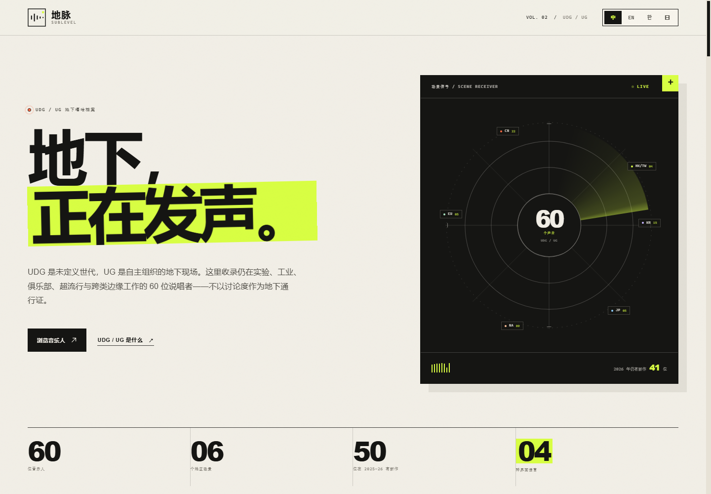
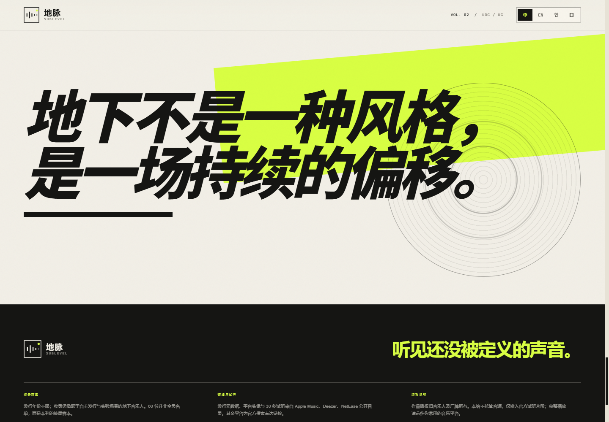

# 地脉 SUBLEVEL / VOL. 02 — UDG / UG

一份关注地下嘻哈前沿、**不按发行年份设限**的四语策展网站。这一版重新收紧了风格分类，并给底部留出一整块标语视觉。

**版本：2026.11.01** · 60 位音乐人 · 6 个地区场景 · 13 种中英双语风格 · 中文 / English / 한국어 / 日本語



---

## 先说明“地下”

**地下不是一种风格，是一场持续的偏移。**

UDG / UG 仍然指自主发行、场景内循环、非主流工业路径。它不是“越少人听越正宗”的等级，也不是某一种固定曲风。筛选标准只有三条：仍在自主发行；仍在推进声音边界；没有被主流工业体系吸收。**发行年份不限。**

## 这一版有什么

- **60 位音乐人 / 6 个地区场景**：中国大陆 22、港台 4、韩国 15、日本 5、北美 9、欧洲 5。
- **13 种中英双语风格**：筛选与卡片使用“英文原名/中文名称”，例如 Plugg/插头音乐、Rage/狂怒说唱。
- **Top Tracks**：按网易云音乐公开热度（pop）排序，每位音乐人 10 首；有 Apple 30 秒预览的可站内试听，其余为 NetEase 外链。
- **平台头像**：优先使用网易云音乐头像，并缓存到本地 `avatars/`；试听档案、卡片封面与播放器统一使用这些头像。
- **发布校对**：全部音乐人的近期发行已重新核对，最后同步 **2026.11.01**。
- **底部标语**：删除原“发行切片”图表区，只保留标语与 A 方案视觉。
- **响度**：界面默认音量仍为 50%，但输出增益固定为 0.5，实际响度约为原来的 **一半（−6 dB）**。
- **完整作品外链**：Spotify、Apple Music、YouTube Music、网易云音乐、QQ 音乐、KKBOX、Melon、Bugs、LINE MUSIC、Amazon Music、SoundCloud、Bandcamp。
- **四语界面**：中文、English、한국어、日本語。

## 这一版调整

### 新增

- **Drogas**（中国）：上海 UDG / plugg，2026 单曲《愛如雨》。
- **Molly Yam**（韩国）：2026《TIKTOKSTA Ⅱ》。
- **R!R!Riot**（台湾）：Dazed 称为 “Taiwan’s pluggnb princess”。
- **hinji**（韩国）：韩国 UDG Freshman Cypher 2026。
- **pakaowlla**（韩国）：韩国 UDG Freshman Cypher 2026。
- **karaika**（韩国）：韩国 UDG Freshman Cypher 2026。

### 不再收录的风格分类

本版删除了 **Boom Bap、Jazz Rap、UK Rap、Horrorcore、Art Rap、Abstract Hip-Hop、Deconstructed Club** 七个分类，并同步清理了只依赖这些分类的条目。剩余 13 种风格：

**Plugg/插头音乐、Pluggnb/插头R&B、Rage/狂怒说唱、Jerk/杰克说唱、Sigilkore/符文核、Digicore/数字核、Hyperpop/超流行、Cloud Rap/云端说唱、Experimental Hip-Hop/实验嘻哈、Industrial Hip-Hop/工业说唱、Alternative Hip-Hop/另类说唱、Emo Rap/情绪说唱、Hip-Hop/嘻哈音乐。**

## 底部标语

“发行切片”整段已删除，只保留 **“地下不是一种风格，是一场持续的偏移。”**

页面底部只保留 A 方案：酸性黄大色块、圆形雷达底纹、黑色特粗斜体。B、C 两个可选项已删除。



## 每日自动更新（GitHub Pages / Actions）

已在仓库根目录加入工作流 `.github/workflows/sublevel-daily.yml`：

- 每天 **16:00 UTC** 运行，也就是**北京时间次日 00:00**；
- 重查近期发行、平台头像和 Top Tracks；
- 数据有变化时自动 commit 回仓库；
- 上传 `sublevel/` 并部署 GitHub Pages；
- 页面底部和“策展方法”里的“最后同步”从 `meta.updated` 动态读取。

启用方式：

1. 推到 GitHub 仓库；
2. **Settings → Pages → Build and deployment → Source: GitHub Actions**；
3. Actions 里手动运行一次 “Daily SUBLEVEL sync”；
4. 之后按 cron 自动执行。

注意：GitHub Actions 的定时任务可能延迟几分钟；如果仓库分支有保护规则，需要允许 `github-actions[bot]` 推送，或改为 PR 流程。时区固定为 `Asia/Shanghai`，北京时间没有夏令时。

## 打开方式

最简单：直接双击 `index.html`。

推荐用本地静态服务器：

```powershell
cd sublevel
python -m http.server 8123
# 打开 http://127.0.0.1:8123/
```

无需安装依赖，无需构建。

## 编辑热度

热度是编辑指数，不是播放量：

| 维度 | 权重 | 含义 |
| --- | ---: | --- |
| 地下边缘性 | 40 | 与主流工业、平台榜单和大众曝光之间的距离 |
| 声音前沿度 | 30 | 是否在实验、工业、俱乐部、超流行或跨类边缘推进 |
| 近作活跃 | 20 | 最近一次正式发行的时间与作品完整度 |
| 编辑推荐 | 10 | 对作品独特性与场景相关性的判断 |

## 数据、头像与同步

- **发行年份不限**。最新项目年份分布：2022 年 1 位、2023 年 1 位、2024 年 4 位、2025 年 8 位、2026 年 46 位。
- 发行元数据、30 秒试听来自 Apple Music；平台头像来自 Deezer / NetEase 公开目录；最后同步 **2026-11-01**。
- **Top Tracks 600 首**，按网易云音乐公开热度排序；Apple 有预览的曲目可站内试听 30 秒，其余跳转网易云。
- 页面只保留 A 方案，不再有 B/C 切换。
- **GitHub Pages** 使用仓库根目录的 Actions 工作流每日同步；本地 `python -m http.server` 不会自动运行计划任务，需要自行用任务计划程序或 cron 触发脚本。
- 各平台没有统一、公开的歌曲点赞 API，Top Tracks 综合平台公开热度与可获取信号排序，不是伪造的实时点赞榜。
- 本站不托管音源，完整作品版权归音乐人及厂牌所有。

### 概念参考

- [Dazed — What does it mean to be 'underground' in 2026?](https://www.dazeddigital.com/music/article/70766/1/what-does-it-mean-to-be-underground-uk-ug-esdeekid-fake-mink)
- [网易云音乐 — UDG 说唱合辑《未定义世代》](https://www.163.com/dy/article/L1BF28NJ05178FFG.html?spss=adap_pc)
- [Dazed — Bloodz Boi: the humble godfather of Chinese underground rap](https://www.dazeddigital.com/music/article/68917/1/bloodz-boi-interview-the-humble-godfather-of-chinese-underground-rap)
- [Dazed — R!R!Riot is Taiwan's pluggnb princess](https://www.dazeddigital.com/music/article/69420/1/rrriot-is-taiwan-s-pluggnb-princess-winter-2025-issue)
- [NME — Nukuluk and the UK experimental hip-hop scene](https://www.nme.com/features/music-interviews/nukuluk-interview-stillworld-mixtape-radar-3816246)

## 文件结构

```text
sublevel/
├─ index.html        页面结构与语义骨架
├─ styles.css        视觉系统、风格控件、Top Tracks、音量控件与响应式布局
├─ manifesto.css     底部 A 方案标语视觉
├─ data.js           60 位音乐人、13 种风格、地区、平台、头像与发行信息
├─ avatars/          网易云音乐头像本地缓存
├─ top-tracks.js     60 位音乐人的 Top Tracks 与 30 秒试听数据
├─ i18n.js           中 / 英 / 韩 / 日四语界面文案
├─ app.js            筛选、搜索、排序、档案、Top Tracks、播放器、音量、标语切换
├─ research/         Apple Music、Deezer、NetEase 目录与同步脚本
└─ README.md
```

## 修改与维护

- 增删音乐人：编辑 `data.js` 的 `ARTISTS`。每位需要四语 `name`、`bio`、`base`，一个 `styles` 数组，以及 `project.preview` 的官方试听地址。
- 风格：编辑 `data.js` 的 `STYLES`；`nameZh` 会与英文名并列显示。
- 头像：`python research/sync_avatars.py` 重新抓取平台头像并写入 `avatar` 字段。
- 发行：`node research/sync_catalog.mjs` 重新核对最新发行与预览。
- 修改资源后，更新 `index.html` 中的 `?v=` 版本号。
- 界面响度：`app.js` 的 `applyVolumeState()` 将 `audio.volume` 固定乘以 `0.5`；界面默认 `0.5`，因此实际输出约为默认响度的一半。

**SUBLEVEL / 地脉** 是一个非商业的场景档案项目。Made for the underground, not the algorithm.
